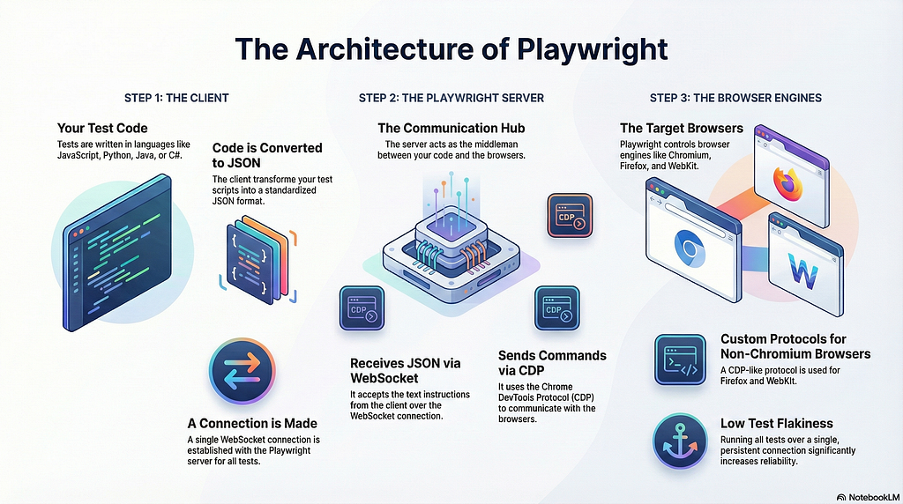

Have you ever run a Playwright test and wondered _what exactly happens under the hood_?  
Playwright isn’t just a testing library — it’s a well-engineered system built on efficient communication channels and smart architectural decisions.

This guide breaks down its architecture in a **simple, visual, and beginner-friendly** way.

### Playwright Architecture — At a Glance

**Playwright has 3 core components + 2 communication protocols.**



### They work together like this:

```
Your Test Code (Client)
          ↓ WebSocket
Playwright Server (Controller)
          ↓ CDP / W1 Protocol
Browser Engines (Chrome / Firefox / WebKit / Edge)
```

### 🧱 The Three Core Components

### ⭐ 1. Client Component

Where your test code lives.  
You write tests using:

-   **JavaScript / TypeScript**
-   **Python**
-   **Java**
-   **C#**

This is your interface to control browsers.

### ⭐ 2. Playwright Server

The **brain** of the system. It:

-   Receives commands from your test code
-   Translates and routes them
-   Communicates with actual browsers

Think of it as the command center between your test and the web browser.

### ⭐ 3. Browser Engines

These are real browsers where your tests run:

-   **Chromium / Chrome**
-   **Firefox**
-   **WebKit**
-   **Edge**

The browser engines perform actions like clicking, navigation, typing, evaluating scripts, and capturing screenshots.

### 🔗 The Two Protocols That Make It All Work

### 🔌 1. WebSocket Protocol

_Used between the Client ↔ Playwright Server_

-   A **single persistent WebSocket connection** is created.
-   All your test steps travel through this **one connection**.
-   Even if you run **10 tests**, they still share the same WebSocket.

### 🔒 Why This Matters

Because this stable connection:

-   Reduces network overhead
-   Minimizes test flakiness
-   Improves execution stability

### 🧠 2. CDP / W1 CDP Protocol

_Used between the Server ↔ Browser Engine_

### 📌 CDP (Chrome DevTools Protocol)

Used when interacting with **Chrome** or **Chromium**.

### 📌 W1 Protocol (Playwright’s custom implementation)

Used when working with **Firefox** and **WebKit**.

These protocols enable browser-level actions like DOM inspection, navigation, network control, and JavaScript execution.

### 🚦 What Happens When You Run a Playwright Test?

Let’s walk through the entire flow:

### ▶️ Step-by-Step Workflow

### 1️⃣ Your test code is converted to JSON

Playwright converts your test into a structured JSON format.

```
{
  "action": "click",
  "selector": "#loginButton"
}
```

### 2️⃣ WebSocket connection is established

The client connects to the Playwright server via a **single WebSocket**.

### 3️⃣ JSON instructions are sent to the server

Your test steps begin flowing to the Playwright server.

### 4️⃣ Server communicates with the browser

The server uses:

-   **CDP** for Chrome/Chromium
-   **W1 protocol** for Firefox/WebKit

It sends low-level commands like:

-   Click element
-   Navigate to URL
-   Fill input
-   Evaluate script

### 5️⃣ Browser executes actions and sends responses back

The server receives browser responses and forwards them to your test code.

### 🚀 Why Playwright Is So Stable & Fast

✔️ **One WebSocket connection → Less overhead**  
✔️ **Efficient JSON-based messaging**  
✔️ **Direct browser control via CDP/W1**  
✔️ **Parallelism and isolation built-in**  
✔️ **Better flakiness resistance** compared to traditional Selenium-based setups

These are some of the reasons why Playwright has become a favorite in modern UI test automation.

### 📌 Final Summary

Playwright’s architecture is built around:

### 3 Components

-   Client
-   Playwright Server
-   Browser Engines

### 2 Protocols

-   WebSocket
-   CDP / W1 CDP

### Result

A high-speed, low-flakiness, consistent automation experience.
